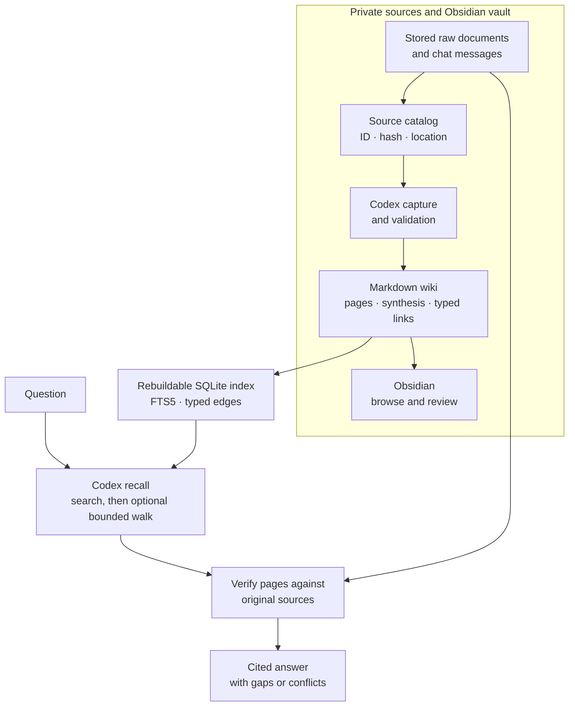
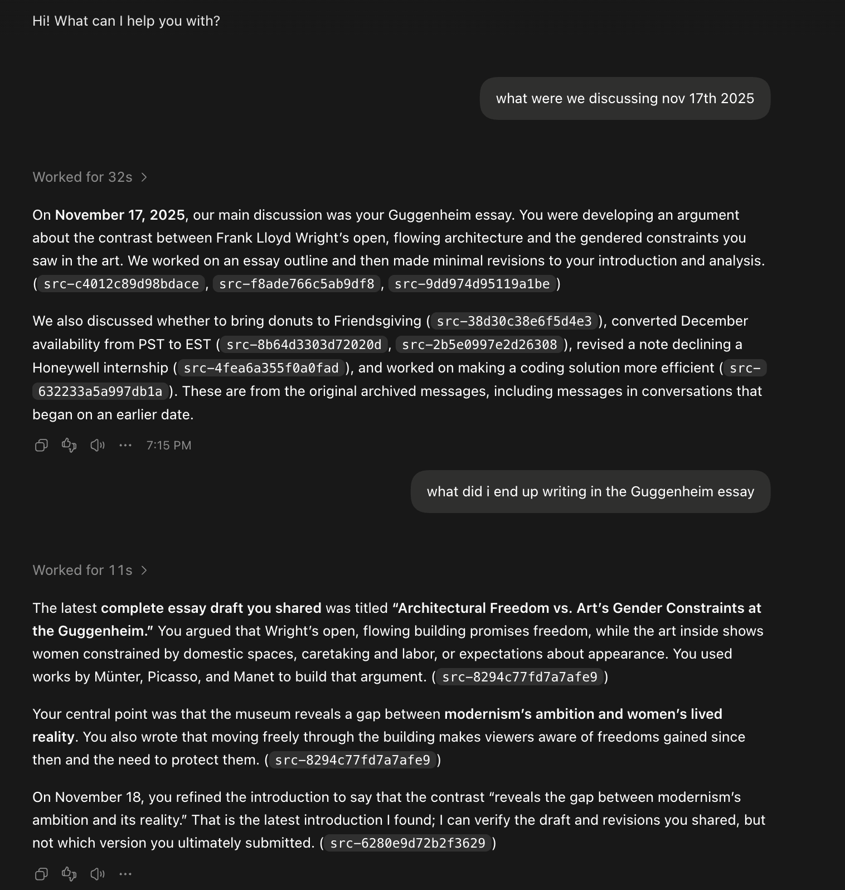

# Second Brain

**I built a source-backed memory layer for Codex that I can inspect in Obsidian and evaluate against Codex’s existing memory.**

An inspectable personal memory layer for Codex. Obsidian displays the Markdown vault; Codex uses agent guidance and small skills to capture sources, retrieve evidence, and synthesize answers. Optional local hooks capture bounded turn text and offer relevant pages when a prompt arrives. A standard-library CLI builds a disposable full-text and typed-graph index. Codex's existing memory remains enabled and independent.

**[Watch the video demo](https://youtu.be/ODDovI6OlB8)** · [Set up your own private vault](GETTING_STARTED.md)

## What it does



The Markdown and source catalog are durable records. The SQLite index is a disposable projection stored outside the vault. The optional hooks record text from supported local Codex turns after they have been reviewed and trusted; wiki facts are still written deliberately from registered sources.

- **Raw sources** can be copied into the private vault with `ingest`, or referenced in a separate private archive with `source`. Identical file bytes reuse one stored copy. Chat imports deduplicate by thread, turn, role, and optional item ID.
- **Wiki pages** are ordinary Markdown with a small frontmatter schema. Obsidian renders links and graph view.
- **Typed relationships** are source-backed rows in a page's `## Relationships` table. The CLI derives graph edges from the same text Obsidian shows.
- **Search and context** use SQLite FTS5 to find pages and original chats; `context` adds a bounded one-hop typed-graph view and checks the originals' hashes.
- **Synthesis** is a Codex workflow, not a second model service: it reads the retrieved pages and sources, cites concrete claims, and identifies gaps.
- **Curation review** flags isolated wiki pages and decision notes missing a rationale section without inventing relationships.

### Graph at a glance


*Fictional illustration of the vault in Obsidian. Its names, files, and graph nodes are synthetic.*

The left pane illustrates stored raw documents and chats beside wiki pages. The graph pane resembles Obsidian's [native Graph view](https://obsidian.md/help/plugins/graph), where wiki links update as Markdown files change. In the private vault, the saved filter focuses on `wiki/` pages and hides raw records and navigation notes. The graph icon in Obsidian's left ribbon opens it. Its **Animate** button replays note creation order, which is not a complete history of changed edges.

The real vault stays private. Generate a typed-graph snapshot of your own vault with:

```bash
python3 graph_view.py --vault /absolute/path/to/private-vault --output /absolute/path/to/private-vault/graph-current.svg --label "My private graph"
```

Open `graph-current.svg` in Obsidian or any browser. Rerun the command after wiki changes; the image is a snapshot, not a live view.

### Source-backed recall in a real chat

<a href="assets/source-backed-recall.png"></a>

*A fresh chat recalled a discussion from a year earlier, cited the archived messages, and distinguished a shared draft from a final submission. The underlying vault remains private.*

## Design references

| Source | Idea used here | Scope in this project |
| --- | --- | --- |
| [Andrej Karpathy, *LLM Wiki*](https://gist.github.com/karpathy/442a6bf555914893e9891c11519de94f) | Raw sources, an evolving linked wiki, and agent instructions that govern capture and retrieval. | The vault keeps these layers visible as files. |
| [Garry Tan, *GBrain*](https://github.com/garrytan/gbrain#architecture) | Typed relationship traversal, synthesis with gap analysis, and a rebuildable index over file-backed knowledge. | A few explicit edge types and a bounded walk; no GBrain service or database stack. |
| [Obsidian, *How Obsidian stores data*](https://obsidian.md/help/Files%2Band%2Bfolders/How%2BObsidian%2Bstores%2Bdata) | A vault is a local folder of Markdown files that can be read and edited by other tools. | Obsidian is the visual editor and graph view; the files remain portable. |
| [Chhikara et al., *Mem0*](https://arxiv.org/abs/2504.19413) | Long-term memory needs extraction, consolidation, and retrieval across conversations; the paper also explores graph memory. | Research context for later chat capture and evaluation, not a dependency or claimed benchmark result. |
| [SQLite, *FTS5 Extension*](https://www.sqlite.org/fts5.html) | A local full-text index can retrieve candidate pages without embedding every source. | The CLI rebuilds FTS5 from the Markdown wiki. |
| [Adam Tyler Lynch, *Obsidian Agent Memory Skills*](https://github.com/adamtylerlynch/obsidian-agent-memory-skills) | Agent orientation and scoped graph navigation keep context compact. | `context` retrieves a bounded source-checked neighborhood on demand. |
| [Moun R., *Three-Layer Memory*](https://pub.towardsai.net/i-gave-my-ai-agent-a-three-layer-memory-obsidian-heres-how-it-thinks-now-0aaa0fdbdbbd) | Raw session history, curated memory, and a navigable vault serve different purposes. | Raw chats and the smaller wiki remain separate; no large context file is injected every turn. |
| [Martin Lepage, *Four Approaches to Agent Memory*](https://dev.to/martinlepage26bit/i-tried-4-approaches-to-ai-agent-memory-heres-what-actually-worked-2a22) | Linked decision notes should preserve the reason and alternatives, not only the outcome. | `graph-audit` flags isolated pages and missing decision rationale for source-backed review. |

These sources shaped the design; this repository is an independent implementation. [The evaluation guide](evals/README.md) describes how to measure its effect.

## Try the fictional demo

Python 3.10+ and SQLite FTS5 are required. No package installation is needed.

```bash
python3 brain.py --vault examples/demo-vault check
python3 brain.py --vault examples/demo-vault index
python3 brain.py --vault examples/demo-vault search "Orbit decision"
python3 brain.py --vault examples/demo-vault walk wiki/people/alex --hops 2
python3 brain.py --vault examples/demo-vault context "Alex and the Orbit pilot"
python3 brain.py --vault examples/demo-vault graph-audit
python3 brain.py --vault examples/demo-vault size
python3 -m unittest discover -s tests -v
```

The index is written beside the vault in `.brain-index/`, not inside the synced vault.

For your own vault, run `python3 brain.py --vault /absolute/path/to/private-vault init`, then follow [the full setup guide](GETTING_STARTED.md) to import ChatGPT export text, add documents, create source-backed wiki pages, connect local Codex hooks, and verify capture.

## Evaluation

Evaluation covers several layers: the fictional retrieval and source-integrity demo passes **8/8** cases; the private vault's search, graph, hook, and source checks pass **72/72** cases; and supported local turns record retrieval and cited-source use as they happen. These checks test retrieval and source integrity. Paired fresh-chat runs also compare the answers Codex gives with and without the vault. Representative query types and observed responses:

| Query type | Without vault | With vault |
| --- | --- | --- |
| An exact limit from an earlier study-app discussion | Said it did not know | Gave the correct number and cited the original |
| Two classifiers named in an earlier research project | Said it did not know | Named both correctly and cited the original |
| A fact absent from the sources | Abstained | Abstained |

The vault-assisted answers in these examples drew on registered originals; the no-vault answers abstained when they lacked the detail. Retrieving and checking sources also took longer. These selected comparisons do not establish a general improvement or a desktop-app baseline. The [evaluation guide](evals/README.md) gives the paired sample size, scoring method, timing, and limitations.

## Live local Codex use

For supported local Codex chats, submitting a prompt registers its bounded text as an original chat source. When the turn finishes, the Stop hook registers the bounded final answer, refreshes a source-linked `ops/RECENT_CONVERSATIONS.md` view for Obsidian, and records retrieval and citation signals. The next prompt can search those originals without a manual import. This automatic capture does not synthesize durable wiki claims or include attachments, tool output, or every intermediate assistant message.

The [optional Codex connection](integrations/codex/README.md) installs global guidance plus `UserPromptSubmit` and `Stop` hooks. In this project's local setup, both fresh local Codex CLI turns and desktop turns have verified prompt capture, relevant page retrieval, final-answer capture, and private telemetry. Hook coverage depends on the Codex client and trust state, so verify it with the steps in the integration guide.

| Moment | Private vault and Obsidian | Evaluation signal |
| --- | --- | --- |
| A supported local prompt arrives | Store bounded prompt text in `raw/inbox/` and register it as an immutable `raw/chats/` source; offer relevant wiki, dated-chat, or original-chat candidates. | Record retrieval latency, candidate IDs, and capture status. |
| Codex identifies a durable, user-stated fact, decision, preference, or correction | Verify the original and update a cited Markdown page in `wiki/`. Obsidian displays the changed files and links. | Add a private, source-grounded retrieval case for substantive wiki or relationship changes. This remains agent work. |
| The turn ends | Register the bounded final answer as a raw source and refresh `ops/RECENT_CONVERSATIONS.md`. | Check captured source hashes and the incremental index; record cited source use. Run the full private regression suite when wiki pages changed. |

The regression cases check search, prompt-hook candidate retrieval, dated-chat recall, graph traversal, and source integrity. The usage log distinguishes evidence merely offered from registered originals explicitly cited in an answer and records the claim that used them. It does **not** grade correctness or prove an improvement over Codex's built-in memory. That requires the [paired fresh-chat eval](evals/README.md), with both conditions using the same existing Codex memory settings. Uploaded attachments and full historical transcripts are outside the hook's capture scope. This connection is for supported **local Codex** sessions; ChatGPT Work, cloud runs, and other devices need separate integration and coverage tests.


