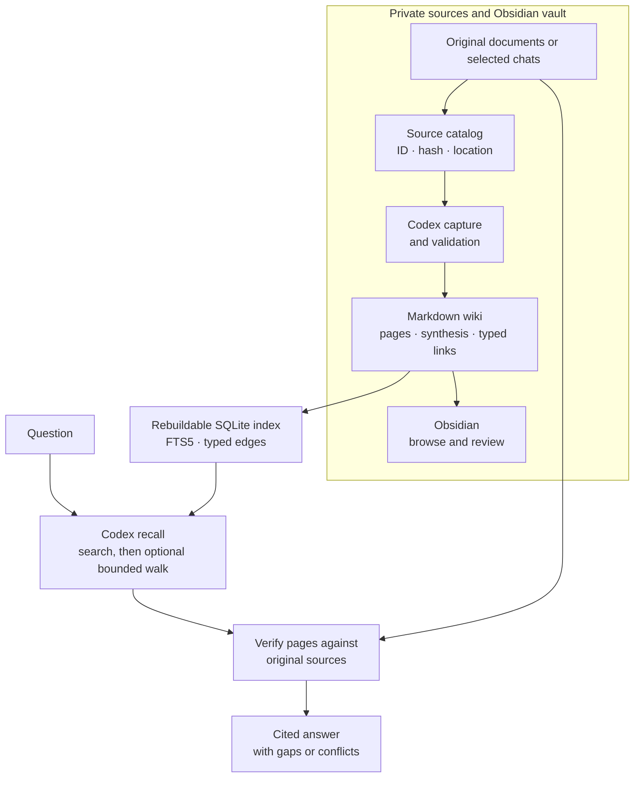

# Second Brain 

An inspectable personal memory layer for Codex. Obsidian displays the Markdown vault; Codex uses three small skills to capture sources, retrieve evidence, and synthesize answers. A standard-library CLI builds a disposable full-text and typed-graph index. Codex's existing memory remains enabled and independent.

This is an original, small implementation inspired by [Karpathy's LLM Wiki](https://gist.github.com/karpathy/442a6bf555914893e9891c11519de94f) and [Garry Tan's GBrain](https://github.com/garrytan/gbrain). It does not install or copy either project.

## What it does



The Markdown and source catalog are durable records. The SQLite index is a disposable projection stored outside the vault. Only selected chats enter the capture path; automatic conversation ingestion is not implemented yet.

- **Raw sources** remain original files. Registration stores a hash and path; it does not duplicate the file.
- **Wiki pages** are ordinary Markdown with a small frontmatter schema. Obsidian renders links and graph view.
- **Typed relationships** are source-backed rows in a page's `## Relationships` table. The CLI derives graph edges from the same text Obsidian shows.
- **Search** uses SQLite FTS5. Both the full-text index and graph projection are rebuilt from Markdown.
- **Synthesis** is a Codex workflow, not a second model service: it reads the retrieved pages and sources, cites concrete claims, and identifies gaps.

## Design references

| Source | Idea used here | Scope in this project |
| --- | --- | --- |
| [Andrej Karpathy, *LLM Wiki*](https://gist.github.com/karpathy/442a6bf555914893e9891c11519de94f) | Raw sources, an evolving linked wiki, and agent instructions that govern capture and retrieval. | The vault keeps these layers visible as files. |
| [Garry Tan, *GBrain*](https://github.com/garrytan/gbrain#architecture) | Typed relationship traversal, synthesis with gap analysis, and a rebuildable index over file-backed knowledge. | A few explicit edge types and a bounded walk; no GBrain service or database stack. |
| [Obsidian, *How Obsidian stores data*](https://obsidian.md/help/Files%2Band%2Bfolders/How%2BObsidian%2Bstores%2Bdata) | A vault is a local folder of Markdown files that can be read and edited by other tools. | Obsidian is the visual editor and graph view; the files remain portable. |
| [Chhikara et al., *Mem0*](https://arxiv.org/abs/2504.19413) | Long-term memory needs extraction, consolidation, and retrieval across conversations; the paper also explores graph memory. | Research context for later chat capture and evaluation, not a dependency or claimed benchmark result. |
| [SQLite, *FTS5 Extension*](https://www.sqlite.org/fts5.html) | A local full-text index can retrieve candidate pages without embedding every source. | The CLI rebuilds FTS5 from the Markdown wiki. |

These sources shaped the design; this repository is an independent implementation. [PLAN.md](PLAN.md) records the tradeoffs and planned evaluation.

## Try the fictional demo

Python 3.10+ and SQLite FTS5 are required. No package installation is needed.

```bash
python3 brain.py --vault examples/demo-vault check
python3 brain.py --vault examples/demo-vault index
python3 brain.py --vault examples/demo-vault search "Orbit decision"
python3 brain.py --vault examples/demo-vault walk wiki/people/alex --hops 2
python3 brain.py --vault examples/demo-vault size
python3 -m unittest discover -s tests -v
```

The index is written beside the vault in `.brain-index/`, not inside the synced vault.

## Use with your own vault

1. Create a private folder and open it as a vault in Obsidian. Do not place private sources in this public repository.
2. Copy `SCHEMA.md` and adapt the `AGENTS.md` guidance to the private vault. Keep the initial `wiki/index.md` and `wiki/now.md` short.
3. Register a source: `python3 brain.py --vault /absolute/path/to/vault source /absolute/path/to/document --title "Document title"`.
4. Ask Codex to use the **brain-capture** skill to create or update source-backed pages, then run `check` and `index`.
5. Ask a question with the **brain-recall** skill. It searches first, traverses typed relationships only when useful, and synthesizes a cited answer.

See [SCHEMA.md](SCHEMA.md) for page and relationship conventions and [PLAN.md](PLAN.md) for scope and future work.

## Boundaries

The CLI does not import every past Codex or ChatGPT conversation automatically. Chat capture coverage must be tested for the environment before any daily ingestion is enabled. A registered external source remains wherever it was saved; the vault record is not its backup. Obsidian Sync and a separate backup can be configured independently.

For a public portfolio repository, use only synthetic examples. Keep the real vault separate and private. Generated `.brain-index/` files should not be committed.
