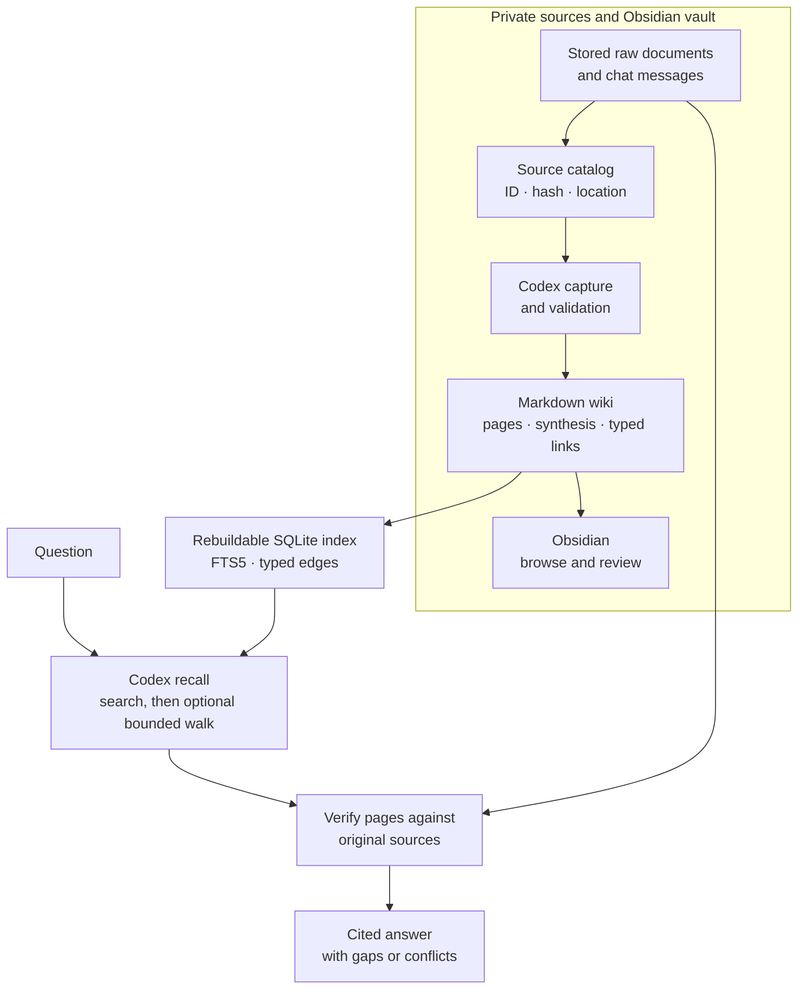
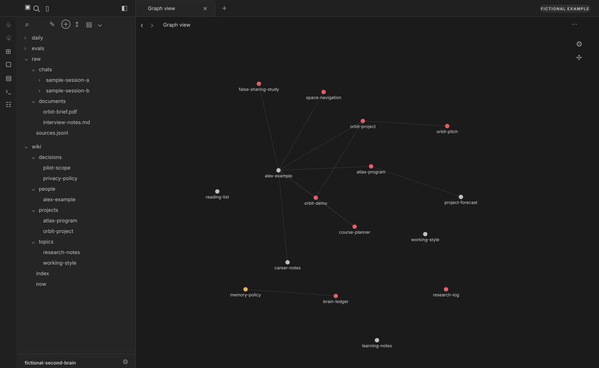
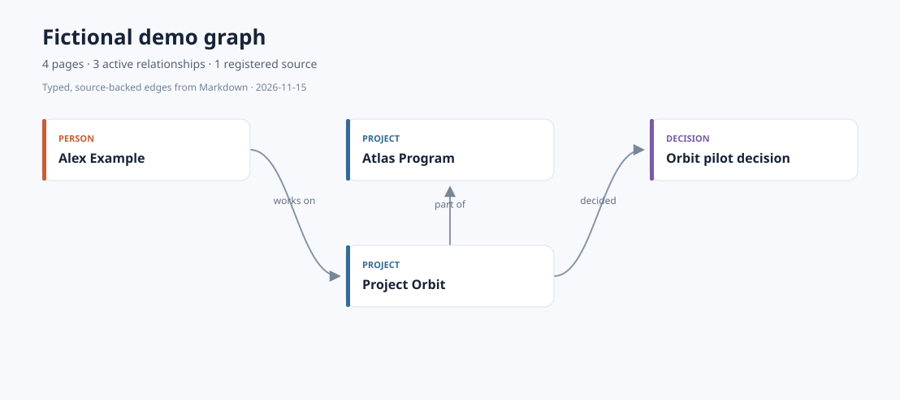

# Second Brain

An inspectable personal memory layer for Codex. Obsidian displays the Markdown vault; Codex uses agent guidance and small skills to capture sources, retrieve evidence, and synthesize answers. Optional local hooks capture bounded turn text and offer relevant pages when a prompt arrives. A standard-library CLI builds a disposable full-text and typed-graph index. Codex's existing memory remains enabled and independent.

This is an original, small implementation inspired by [Karpathy's LLM Wiki](https://gist.github.com/karpathy/442a6bf555914893e9891c11519de94f) and [Garry Tan's GBrain](https://github.com/garrytan/gbrain). It does not install or copy either project.

## What it does



The Markdown and source catalog are durable records. The SQLite index is a disposable projection stored outside the vault. The optional hooks record text from supported local Codex turns after they have been reviewed and trusted; wiki facts are still written deliberately from registered sources.

- **Raw sources** can be copied into the private vault with `ingest`, or referenced in a separate private archive with `source`. Identical file bytes reuse one stored copy. Chat imports deduplicate by thread, turn, role, and optional item ID.
- **Wiki pages** are ordinary Markdown with a small frontmatter schema. Obsidian renders links and graph view.
- **Typed relationships** are source-backed rows in a page's `## Relationships` table. The CLI derives graph edges from the same text Obsidian shows.
- **Search** uses SQLite FTS5. Both the full-text index and graph projection are rebuilt from Markdown.
- **Synthesis** is a Codex workflow, not a second model service: it reads the retrieved pages and sources, cites concrete claims, and identifies gaps.

### Graph at a glance



*Fictional illustration of the vault in Obsidian. All names, files, and graph nodes are synthetic; no private vault content appears in this repository.*

The left pane illustrates stored raw documents and chats beside wiki pages. The graph pane resembles Obsidian's [native Graph view](https://obsidian.md/help/plugins/graph), where wiki links update as Markdown files change. In the private vault, the saved filter focuses on `wiki/` pages and hides raw records and navigation notes. The graph icon in Obsidian's left ribbon opens it. Its **Animate** button replays note creation order, which is not a complete history of changed edges.

<details>
<summary>See the stricter typed graph used by the search engine</summary>



This second picture is generated from the fictional demo vault. Each box is a wiki page; arrows are active, typed relationships backed by a registered source. It is a static snapshot, separate from Obsidian's live wiki-link graph.

</details>

The real vault stays private. Generate a typed-graph snapshot of your own vault with:

```bash
python3 graph_view.py --vault /absolute/path/to/private-vault --output /absolute/path/to/private-vault/graph-current.svg --label "My private graph"
```

Open `graph-current.svg` in Obsidian or any browser. Rerun the command after wiki changes; the image is a snapshot, not a live view.

## Design references

| Source | Idea used here | Scope in this project |
| --- | --- | --- |
| [Andrej Karpathy, *LLM Wiki*](https://gist.github.com/karpathy/442a6bf555914893e9891c11519de94f) | Raw sources, an evolving linked wiki, and agent instructions that govern capture and retrieval. | The vault keeps these layers visible as files. |
| [Garry Tan, *GBrain*](https://github.com/garrytan/gbrain#architecture) | Typed relationship traversal, synthesis with gap analysis, and a rebuildable index over file-backed knowledge. | A few explicit edge types and a bounded walk; no GBrain service or database stack. |
| [Obsidian, *How Obsidian stores data*](https://obsidian.md/help/Files%2Band%2Bfolders/How%2BObsidian%2Bstores%2Bdata) | A vault is a local folder of Markdown files that can be read and edited by other tools. | Obsidian is the visual editor and graph view; the files remain portable. |
| [Chhikara et al., *Mem0*](https://arxiv.org/abs/2504.19413) | Long-term memory needs extraction, consolidation, and retrieval across conversations; the paper also explores graph memory. | Research context for later chat capture and evaluation, not a dependency or claimed benchmark result. |
| [SQLite, *FTS5 Extension*](https://www.sqlite.org/fts5.html) | A local full-text index can retrieve candidate pages without embedding every source. | The CLI rebuilds FTS5 from the Markdown wiki. |

These sources shaped the design; this repository is an independent implementation. [The evaluation guide](evals/README.md) describes how to measure its effect.

## Try the fictional demo

Python 3.10+ and SQLite FTS5 are required. No package installation is needed.

```bash
python3 brain.py --vault examples/demo-vault check
python3 brain.py --vault examples/demo-vault index
python3 brain.py --vault examples/demo-vault search "Orbit decision"
python3 brain.py --vault examples/demo-vault walk wiki/people/alex --hops 2
python3 brain.py --vault examples/demo-vault size
python3 -m unittest discover -s tests -v
```

The index is written beside the vault in `.brain-index/`, not inside the synced vault.

## Evaluation

Run `python3 evals/run.py` for a read-only retrieval and source-integrity smoke check. The included fictional demo currently passes 8/8 cases, with the expected page ranked first in 3/4 search questions. See [the dated results](evals/RESULTS.md) and [the paired answer-eval protocol](evals/README.md). These numbers do not measure personal recall or generated-answer quality.

## Live local Codex use

The [optional Codex connection](integrations/codex/README.md) installs global guidance plus `UserPromptSubmit` and `Stop` hooks. In this project's local setup, fresh local Codex CLI turns have now verified prompt capture, relevant page retrieval, final-answer capture, and private telemetry. A desktop prompt has also produced a private inbox record; desktop `Stop` dispatch has not yet been observed. Hook coverage depends on the Codex client and trust state, so verify it with the steps in the integration guide.

| Moment | Private vault and Obsidian | Evaluation signal |
| --- | --- | --- |
| A supported local prompt arrives, once hooks are trusted | Store up to 64 KB of prompt text in a compressed `raw/inbox/` turn record; search the wiki and offer up to two candidate pages. | Record retrieval latency, page IDs, and errors for this turn. |
| Codex identifies a durable, user-stated fact, decision, preference, or correction | Register the inbox record or original document in `raw/sources.jsonl`; update a cited Markdown page in `wiki/`. Obsidian displays the changed files and links automatically. | Add a private, source-grounded retrieval case for substantive wiki or relationship changes. This is agent work, not an automatic fact extractor. |
| The turn ends | Append bounded final-answer text to the private turn record. If the wiki or source catalog changed, run the private retrieval regression suite. | Append `evals/live.jsonl` telemetry and write `evals/latest.json` for a detected change. A failure can be fixed before the task finishes. |

The regression cases check retrieval, graph traversal, and source integrity. They do **not** grade the generated answer or prove an improvement over Codex's built-in memory. That requires the [paired fresh-chat eval](evals/README.md), with both conditions using the same existing Codex memory settings. Uploaded attachments and full historical transcripts are outside the hook's capture scope. This connection is for supported **local Codex** sessions; ChatGPT Work, cloud runs, and other devices need separate integration and coverage tests.

## Use with your own vault

1. Create a private folder and open it as a vault in Obsidian. Do not place private sources in this public repository.
2. Copy `SCHEMA.md` and adapt the `AGENTS.md` guidance to the private vault. Keep the initial `wiki/index.md` and `wiki/now.md` short.
3. Store a raw document: `python3 brain.py --vault /absolute/path/to/vault ingest /absolute/path/to/document --title "Document title"`. The default per-file limit is 50 MB; use `--max-mb` when intentionally storing a larger file. For an original already kept in a separately backed-up private archive, use `source` to reference it without copying.
4. Import raw chats from a JSONL export: `python3 brain.py --vault /absolute/path/to/vault chat-import /absolute/path/to/chat.jsonl`. Each line needs `thread_id`, `turn_id`, `role`, and `text`; an optional `item_id` distinguishes multiple messages in a turn. Repeated imports reuse the stored messages.

   ```json
   {"thread_id":"chat-123","turn_id":"turn-1","role":"user","text":"My original message","created_at":"2026-11-15T10:00:00Z"}
   ```

5. Ask Codex to use the **brain-capture** skill to create or update source-backed pages, then run `check` and `index`.
6. Ask a question with the **brain-recall** skill. It searches first, traverses typed relationships only when useful, and synthesizes a cited answer.

See [SCHEMA.md](SCHEMA.md) for page and relationship conventions and [the evaluation guide](evals/README.md) for how to test memory performance.

## Boundaries

The CLI does not import every past Codex or ChatGPT conversation automatically. The optional hook stores bounded local turns; full chat exports need `chat-import`. Uploaded attachments need a separate `ingest` step. Content hashes remove exact document duplicates, and stable message IDs remove repeated chat turns; similar versions remain separate for review. A registered external source remains wherever it was saved; the vault record is not its backup. Obsidian Sync and a separate backup can be configured independently.

For a public portfolio repository, use only synthetic examples. Keep the real vault separate and private. Generated `.brain-index/` files should not be committed.
